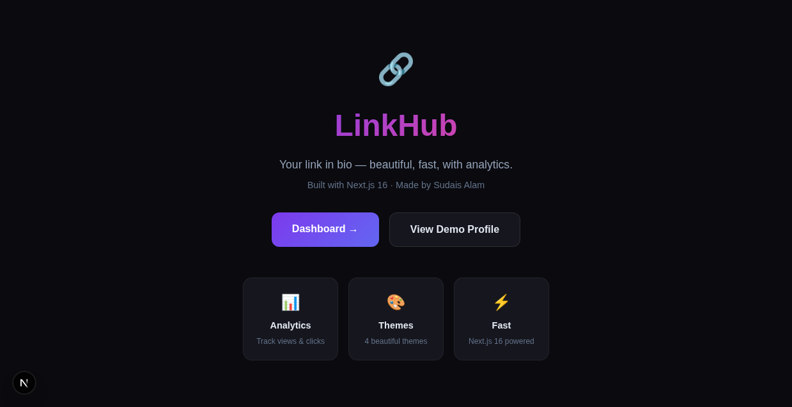
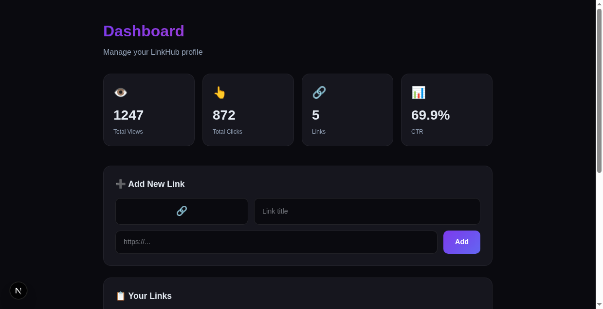
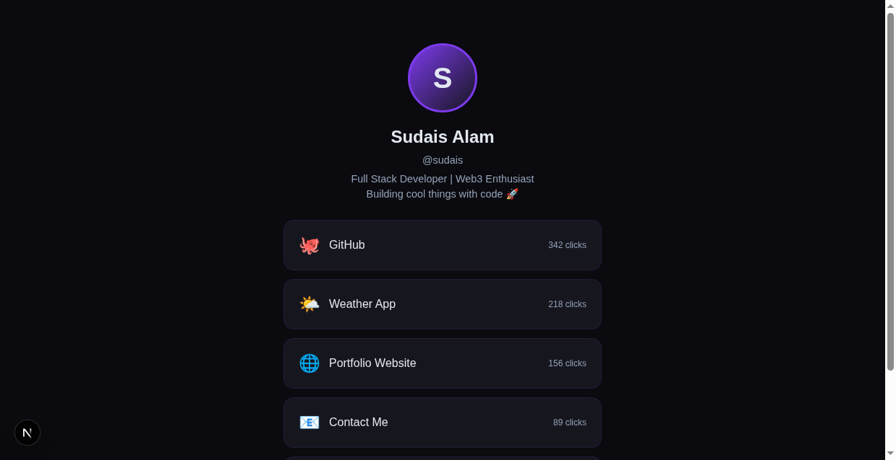

# 🔗 LinkHub — Your Link in Bio

A modern, fast link-in-bio builder with analytics, themes, and a clean dashboard. Built with Next.js 16.

> **Made by Sudais Alam**

## Preview

<table>
  <tr>
    <td width="50%" align="center"><b>🏠 Home</b></td>
    <td width="50%" align="center"><b>📊 Dashboard</b></td>
  </tr>
  <tr>
    <td width="50%"></td>
    <td width="50%"></td>
  </tr>
  <tr>
    <td width="50%" align="center"><b>👤 Profile Page</b></td>
    <td width="50%" align="center"><b>🎨 Banner</b></td>
  </tr>
  <tr>
    <td width="50%"></td>
    <td width="50%"></td>
  </tr>
</table>

## Features

- 📊 **Analytics** — Track views, clicks, and CTR per link
- 🎨 **4 Themes** — Dark, Light, Sunset, Ocean
- ⚡ **Fast** — Next.js 16 with API routes
- 📋 **Dashboard** — Add/remove links, view stats
- 👤 **Public Profile** — Beautiful link-in-bio page at `/{username}`
- 🔗 **Link Management** — Add, remove, track clicks

## Quick Start

```bash
git clone https://github.com/sudaisalamboy/linkhub.git
cd linkhub
bun install
bun run dev
```

Open http://localhost:3001

## Tech Stack

- Next.js 16 (App Router)
- React 19
- TypeScript 5
- Tailwind CSS 4

## API Routes

| Route | Method | Description |
|-------|--------|-------------|
| `/api/profile/[username]` | GET | Fetch profile + increment view |
| `/api/stats` | GET | Get analytics stats |
| `/api/links` | GET | List all links |
| `/api/links` | POST | Add a new link |
| `/api/links?id=xxx` | DELETE | Remove a link |

## Pages

- `/` — Landing page
- `/dashboard` — Admin dashboard with stats + link management
- `/{username}` — Public profile page (link-in-bio)

---
Made with ♥ by **Sudais Alam**
